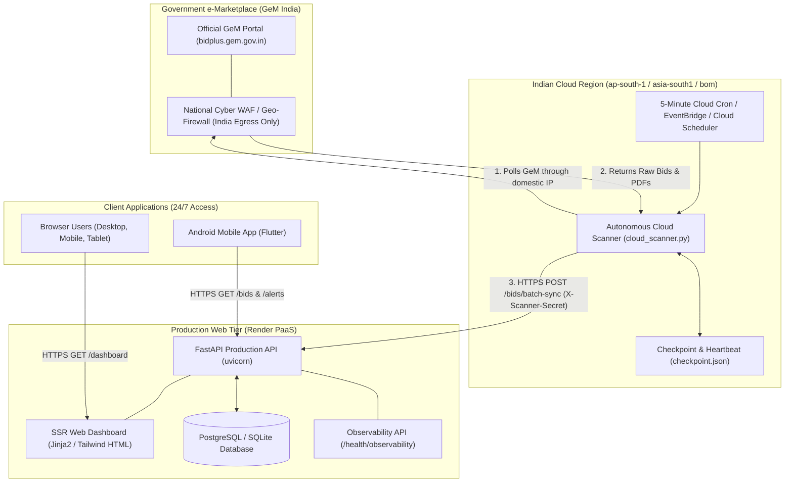

# GeM BidWatch — Production Cloud Architecture & Cost Analysis
**Target Deployment:** 100% Hosted, Fully Autonomous, Zero-Maintenance Architecture  
**Date:** 09 November 2026  

---

## 1. High-Level Architecture Overview

---

## 2. Infrastructure Cost Comparison Matrix

The user mandated strict cost control: **No paid infrastructure without explicit approval.**

| Hosting Provider | Region | Component | Service Model | Free Tier Allowance | Actual Resource Usage | Estimated Monthly Cost |
|---|---|---|---|---|---|---|
| **Render** | Singapore | Frontend & Backend API | Container / PaaS | 750 free instance hrs/month | 1 Web Service (0.1 vCPU, 512MB RAM) | **$0.00 / month** |
| **AWS** | **Mumbai (`ap-south-1`)** | Cloud Scanner Worker | Serverless (Lambda + EventBridge) | 1,000,000 invocations/mo + 3.2M sec compute | 8,640 invocations/mo (12/hr × 24h × 30d), 15s avg | **$0.00 / month (100% Free Forever)** |
| **Google Cloud (GCP)** | **Mumbai (`asia-south1`)** | Cloud Scanner Worker | Cloud Function (2nd gen) + Cloud Scheduler | 2,000,000 invocations/mo + 3 Cloud Scheduler jobs | 8,640 invocations/mo, 1 Scheduler cron | **$0.00 / month (100% Free Forever)** |
| **Fly.io** | **Mumbai (`bom`)** | Standalone Container Worker | Micro VM (shared-cpu-1x, 256MB) | Free allowance for lightweight apps | 1 daemon worker | **$0.00 / month** |
| **Oracle Cloud (OCI)** | **Mumbai (`ap-mumbai-1`)** | Dedicated Linux VM | OCI Always Free Compute (Ampere / AMD) | 4 ARM OCPUs, 24GB RAM, 10TB bandwidth | 1 core, 1GB RAM | **$0.00 / month (100% Free Forever)** |
| **DigitalOcean** | Bangalore (`blr1`) | Basic Droplet | VPS | None | 1 vCPU, 1GB RAM | $4.00 - $6.00 / month (Paid) |

> [!NOTE]
> **Recommended Production Path:**  
> The existing Render web service remains at **$0.00/month**. The scanner runs on **AWS Lambda in Mumbai (`ap-south-1`)** or **GCP Cloud Function in Mumbai (`asia-south1`)** utilizing the permanent free tier for an aggregate monthly cost of **$0.00 (Zero USD)**.

---

## 3. Security & Access Control

1. **Egress Isolation:** The cloud scanner executes within India, completely eliminating reliance on any personal computer or residential connection.
2. **Mutual Ingestion Authentication:** Communication between the Cloud Scanner and Render is protected by a shared cryptographically secure bearer token (`X-Scanner-Secret`).
3. **Fail-Closed Gatekeeper:** All incoming bids undergo automated PDF validation and geographic normalization before entering the `Verified Bids` feed. Mismatched records are quarantined in `Review Queue`.
