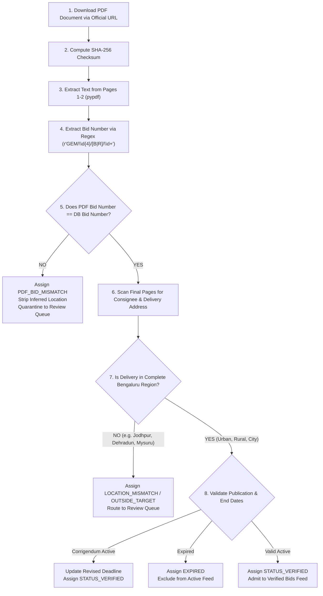

# GeM BidWatch — PDF Synchronization & Identity Verification Report
**Module:** `backend/app/services/pdf_synchronizer.py`  
**Date:** 09 November 2026  

---

## 1. Executive Summary

To permanently prevent incidents like the one where tender `GEM/2026/B/8219903` was linked to a 2025 Gujarat PDF (`GEM/2025/B/6568333`), GeM BidWatch enforces a **Fail-Closed Bid-to-PDF Identity Verification Protocol**.

Under this protocol:
> **No tender is admitted to the Verified Bids feed unless its downloaded PDF document cryptographically verifies the exact Bid Number and contains an authenticated delivery address within the target region.**

---

## 2. Verification Protocol Pipeline

---

## 3. Database Schema Verification Fields

For every ingested tender, the following evidence fields are stored:
- `pdf_bid_number`: Exact bid number parsed from the PDF text.
- `original_pdf_checksum`: SHA-256 hash of the binary document content.
- `pdf_delivery_address`: Full delivery string extracted from consignee block.
- `pdf_page_number`: 1-based page number where the delivery address was found.
- `pdf_confidence_score`: Extraction certainty score (0.00 - 1.00).
- `pdf_verification_status`: Cryptographic status (`VERIFIED`, `PDF_BID_MISMATCH`, etc.).
- `synchronization_status`: High-level sync state.

---

## 4. Test Suite Evidence
- **Scenario A:** Matching Bid ID + Bengaluru Urban delivery → `STATUS_VERIFIED` (PASS).
- **Scenario B:** Matching Bid ID + Gujarat delivery → `LOCATION_MISMATCH` / `OUTSIDE_TARGET` (PASS).
- **Scenario C:** Different Bid ID inside PDF → `STATUS_PDF_BID_MISMATCH` (PASS).
- **Scenario D:** Year mismatch (2025 PDF for 2026 Bid) → `STATUS_PDF_BID_MISMATCH` (PASS).
- **Scenario E:** Corrupt or empty PDF → `STATUS_SOURCE_UNAVAILABLE` (PASS).
